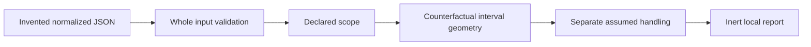

# HTTP Byte Range Lab

An offline Python learning model of normalized single-range geometry and declared
server handling. It explains inclusive offsets, open/suffix requests, clamping and
invalid versus unsatisfiable ranges. It never reads a representation or sends HTTP.

An interval describes counterfactual GET geometry; a hypothetical status depends on
supplied baseline, method, If-Range outcome and server choice. Coding names and length
are metadata. Byte offsets count the selected encoded representation's octets.

## Run and demo

Verified on Windows CPython 3.13.7; standard-library application, no installation needed.
From this directory:

```powershell
python -m rangelab fixtures/cases.json
python -m rangelab fixtures/cases.json --format markdown --output new-demo.md
python -m unittest discover -s tests -v
python -O -m unittest discover -s tests -v
python tools/verify.py --output reports/new-verification
```

Full demo exits **2** because 12 of 40 scenarios are unsupported; all results are emitted.
Exit 0 means a supported report, including modeled ignores/rejections, not HTTP success.
Exit 1 means admission/delivery failure; argument syntax errors separately exit 2.
File output must be fresh: no overwrite or input alias. The verifier requires the
existing Bandit installation and a fresh project-owned directory; it installs nothing.

```python
from pathlib import Path
from rangelab import parse, evaluate

report = evaluate(parse(Path("fixtures/cases.json").read_bytes()))
print(report["results"][0]["interval"])  # {"first": 2, "last": 4}
```

Public API accepts bounded concrete builtins through evaluate, exact UTF-8 bytes through
parse; no custom-object coercion or generator iteration. Reporter helpers take evaluated
records only. Complete validation precedes all semantic output, including later cases.

| Declared case | Geometry | Hypothetical handling |
|---|---|---|
| length 10, closed 2..4 | [2,4], three bytes | 206 under honor policy |
| length 10, closed 7..99 | [7,9], three bytes | clipped 206 |
| length 10, suffix 12 | [0,9], ten bytes | 206, oversized suffix valid |
| length 10, suffix 0 | unsatisfiable, zero bytes | chosen 416 |
| length 10, reversed 7..6 | invalid, count unknown | chosen ignore/200 |
| length 0, suffix 1 | satisfiable-empty, zero bytes | unsupported handling |
| closed 2..4, baseline 304 | same independently known geometry | ignore, supplied 304 |
| closed 2..4, If-Range mismatch | same geometry | ignore, hypothetical 200 |
| absent Range with unknown length | unknown global context | conservatively unsupported |

[JSON demo](reports/verification-cli-final/demo.json) and
[Markdown demo](reports/verification-cli-final/demo.md) include every declaration,
reason, trace, interval/count and fixed assumption. A zero count is distinct from
unknown/null. Positive suffix over empty data never creates 0..-1 or an invented 416.
Original unit/coding token spelling is retained while ASCII comparison ignores case.



## Architecture, security and limits

[CONTRACT.md](CONTRACT.md) defines exact fields/priority/null/bounds;
[PLAN.md](PLAN.md) records approval; [RESEARCH.md](RESEARCH.md) compares actual candidate
sources and explains the original stdlib choice. Reference:
[RFC 9110 byte ranges](https://httpwg.org/specs/rfc9110.html#byte.ranges).

The supplied completed baseline already includes normal/precondition checks. If-Range
is a supplied outcome; this model does not evaluate tags/dates or import the preceding
lab. Policy honor/ignore is invented, not observed server support. Status/header strings
are explanations in JSON/Markdown, not responses. No raw HTTP parsing, files/body
slicing, compression, actual lengths, multipart, authentication, resource mutation,
cache merging, resumption correctness, server/browser/network or full conformance.

Bounded byte/tree/token validation and escaping protect this local teaching interface.
Host process/paths/standard descriptors are trusted; no hostile filesystem-race,
special-file, hard memory/time, atomic stdout/durability or OS-isolation guarantee.
Partial stdout can be delivered before failure. A failed standard stream redirects to
the OS null sink to avoid Python's shutdown flush replacing the chosen exit with 120;
if redirection fails, its Python stream slots are detached. Diagnostics use one checked
write/flush, with no delivery fallback. Host failures remain outside general process
guarantees. Fresh-file failures attempt cleanup and disclose cleanup failure. See SECURITY.md.

Explicit empty output and NUL paths fail with fixed codes before filesystem access;
empty output never selects stdout. Help delivery is checked, and argument errors emit
only ARGUMENT_ERROR. Native paths/error text are not diagnostics. Failed diagnostics
preserve the selected exit in the tested boundaries.

## Verified outcomes and learning

32 tests pass in normal and optimized Python, including actual CLI children and closed
stdout at four sizes; 704 independent tiny-index oracle cases. 40 hand-selected scenarios:
28 supported/12 unsupported. Compile/Bandit pass (six narrow fixed-command test/verifier
subprocess exclusions, none in the application). Four intended mutants produce assertion
failures (23/3/4/5), source restored exactly and 32 tests pass afterward. All 11 final
checks and ten current receipt hashes match. See VERIFICATION.md and REVIEW.md.
The coordinator's later CLI review exposed empty-output fallback and unchecked stderr
missed in the earlier self-review. Those corrections have 24 recorded actual normal/
optimized process-boundary checks, including both streams closed, help and argument errors.

Contract and expected labels were frozen before application code. Five fixture inputs
intended to contain null Range were corrected after the first test run; expected answers
and contract stayed byte-identical. Original freeze evidence is preserved. This correction
is disclosed in [research/FREEZE-CORRECTION.md](research/FREEZE-CORRECTION.md).
ECC review is implementing-agent self-review, not independent audit. Manual boundary
review remains pending; no hosted/other-runtime/Linux/upstream/live or dedicated
secret/history-scan assurance. No repository creation/publication/merge/deployment.

DECISIONS.md and LEARNING.md capture useful distinctions and fixes. Optional exercise:
explain why a positive suffix of an empty representation has zero selected bytes but
is not classified as an unsatisfiable request in this model.

## License and AI assistance

MIT, copyright 2026 Jake. Admission/report/CLI/verifier patterns adapted from Jake's
MIT precondition/cache/CORS labs, which remain unchanged. No Werkzeug/aiohttp code or
upstream vectors copied. Their research license obligations are documented separately.
Codex implemented, self-reviewed and verified the lab. Local qwen3.5:2b extracted three
supplied learning reminders (5365 ms), all source-reviewed/accepted; it did not generate
the oracle or make security decisions. Raw/reviewed drafts and first EACCES evidence
remain separate. No remote inference, dependencies installed or paid calls.


## Publication status

See [publication review](PUBLICATION.md) for the October 5 source snapshot, fresh local checks, evidence boundaries and current hosted-check distinction.
